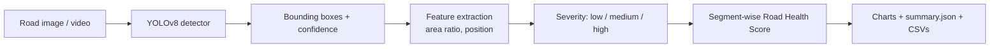

# 🚧 Pothole Detection & Road Analytics

A deep-learning project that **detects potholes** in road images/videos with a fine-tuned **YOLOv8** model and turns the raw detections into **road-condition analytics**: pothole severity, a per-segment *road health score*, and summary charts.

> Course assignment project — Deep Learning / Computer Vision.

---

## ✨ Features

- **Object detection** — fine-tune a pretrained YOLOv8 model on a pothole dataset (transfer learning).
- **Inference on anything** — a single image, a folder of images, or a video (with optional frame skipping).
- **Severity grading** — each pothole is graded *low / medium / high* from the fraction of the frame its bounding box covers.
- **Road health score (0–100)** — every road segment gets a score and a rating (*Good / Fair / Poor / Critical*).
- **Auto-generated report** — `summary.json`, CSV tables and 4 charts per run.
- **Tested analytics layer** — `pytest` unit tests that run without a GPU or dataset.

## 🧠 How it works



### Model
YOLOv8 (Ultralytics) is a one-stage, anchor-free detector. We start from **COCO-pretrained weights** (`yolov8n.pt`) and fine-tune on a single-class (`pothole`) dataset. Transfer learning lets us reach good accuracy with a small dataset and a modest GPU (or Google Colab / Kaggle).

### Analytics

| Step | Formula / rule |
|---|---|
| Area ratio | `bbox_area / frame_area` |
| Severity | `< 0.5%` → **low**, `0.5%–2%` → **medium**, `≥ 2%` → **high** |
| Weighted damage | low = 1, medium = 2.5, high = 5 per detection |
| Segment | `N` consecutive frames (default 30) of one video / image folder |
| **Road health score** | `100 × exp(−k × weighted_damage_per_frame)` with `k = 1` |
| Rating | `≥80` Good · `≥60` Fair · `≥40` Poor · `<40` Critical |

The exponential form keeps the score bounded in **(0, 100]**, equals 100 on a clean road, and decays smoothly as damage increases. Thresholds and weights are configurable (`configs/analytics.yaml`, `src/analytics.py`).

## 📁 Project structure

```
pothole-detection/
├── src/
│   ├── train.py          # fine-tune YOLOv8
│   ├── evaluate.py       # precision / recall / mAP on val or test split
│   ├── detect.py         # inference on images / folders / video + analytics
│   ├── analytics.py      # severity, health score, charts, summary
│   └── utils.py
├── scripts/
│   ├── split_dataset.py  # split flat YOLO dataset into train/val/test
│   └── demo_analytics.py # analytics demo on synthetic data (no model needed)
├── tests/test_analytics.py
├── configs/analytics.yaml
├── data/data.yaml        # dataset config (images are NOT committed)
├── requirements.txt
└── README.md
```

## ⚙️ Setup

```bash
git clone https://github.com/<your-username>/pothole-detection.git
cd pothole-detection

python -m venv .venv
source .venv/bin/activate        # Windows: .venv\Scripts\activate
pip install -r requirements.txt
```

> For GPU training install the CUDA build of PyTorch first: <https://pytorch.org/get-started/locally/>.
> No GPU? Train on **Google Colab** or **Kaggle Notebooks** (free GPU) using the same commands.

Quick sanity check (no dataset needed):

```bash
python scripts/demo_analytics.py
pytest -q
```

## 📦 Dataset

Use any pothole dataset in **YOLO format** (`images/` + `labels/*.txt`, one class: `pothole`). Good places to find one:

- [Roboflow Universe](https://universe.roboflow.com) — search "pothole", export as **YOLOv8** format
- [Kaggle Datasets](https://www.kaggle.com/datasets) — search "pothole detection"

Always check the dataset's **license** and cite it (see *Acknowledgements*).

If your download is a single flat folder, split it:

```bash
python scripts/split_dataset.py --src raw_dataset --dst data/pothole --val 0.15 --test 0.15
```

Expected layout (matches `data/data.yaml`):

```
data/pothole/
├── images/{train,val,test}/
└── labels/{train,val,test}/
```

If your dataset was exported with its own `data.yaml` (Roboflow does this), just pass that file with `--data`.

## 🚀 Usage

### 1. Train
```bash
python -m src.train --data data/data.yaml --model yolov8n.pt --epochs 50 --batch 16 --device 0
```
Best weights are saved to `runs/pothole/yolov8n/weights/best.pt`. Training curves, confusion matrix and PR curves are saved in the same folder.

### 2. Evaluate
```bash
python -m src.evaluate --weights runs/pothole/yolov8n/weights/best.pt --split test
```
Writes `outputs/metrics.json` with precision, recall, mAP@0.5 and mAP@0.5:0.95.

### 3. Detect + analyse
```bash
# a video (process every 2nd frame for speed)
python -m src.detect --weights runs/pothole/yolov8n/weights/best.pt \
    --source road.mp4 --out outputs/road --frame-stride 2

# a folder of images (treated as one ordered road sequence)
python -m src.detect --weights runs/pothole/yolov8n/weights/best.pt \
    --source samples/ --out outputs/samples
```

Output folder:

```
outputs/road/
├── annotated/                 # images / video with boxes drawn
├── detections.csv             # one row per detected pothole
├── frames.csv                 # one row per processed frame
└── analytics/
    ├── summary.json           # overall health score, severity counts, worst segments
    ├── segments.csv           # per-segment score + rating
    ├── detections_enriched.csv
    └── charts/                # severity, health-by-segment, confidence, spatial heatmap
```

## 📊 Results

> ⚠️ Fill this section with **your own** numbers after training — don't leave placeholders in the final submission.

| Model | Epochs | Precision | Recall | mAP@0.5 | mAP@0.5:0.95 |
|---|---|---|---|---|---|
| YOLOv8n | _ | _ | _ | _ | _ |

Add screenshots from `runs/pothole/.../` (`results.png`, `confusion_matrix.png`) and `outputs/.../analytics/charts/`, e.g.:

```markdown


```

## ⚠️ Limitations

- **Severity is a proxy.** It uses bounding-box size relative to the frame, so it depends on camera height/angle and distance. It is not a physical depth/volume measurement.
- **Double counting in video.** The same pothole can appear in many consecutive frames, so counts are *detections*, not unique potholes. The health score is a damage-density measure, not a pothole inventory. (Adding object tracking, e.g. ByteTrack, would fix this.)
- **No GPS.** Segments are frame-based; they are not mapped to real-world road locations.
- Performance depends on dataset quality — lighting, wet roads, shadows and road markings can cause false positives.

## 🔭 Future work

- Multi-object tracking to count *unique* potholes per video
- Merge GPS logs to build a pothole map / heatmap of a route
- Depth or stereo estimation for real severity (depth/volume)
- Compare YOLOv8n/s/m and export to ONNX / TensorRT for edge deployment
- Streamlit dashboard for uploading a video and viewing the report

## 🧪 Tests

```bash
pytest -q
```

## 🙏 Acknowledgements

- [Ultralytics YOLOv8](https://github.com/ultralytics/ultralytics)
- Dataset: _add dataset name, author and link here_

## 📄 License

MIT — see [LICENSE](LICENSE). Note that Ultralytics YOLOv8 is licensed under AGPL-3.0; check its terms if you plan to redistribute or deploy this work commercially.
